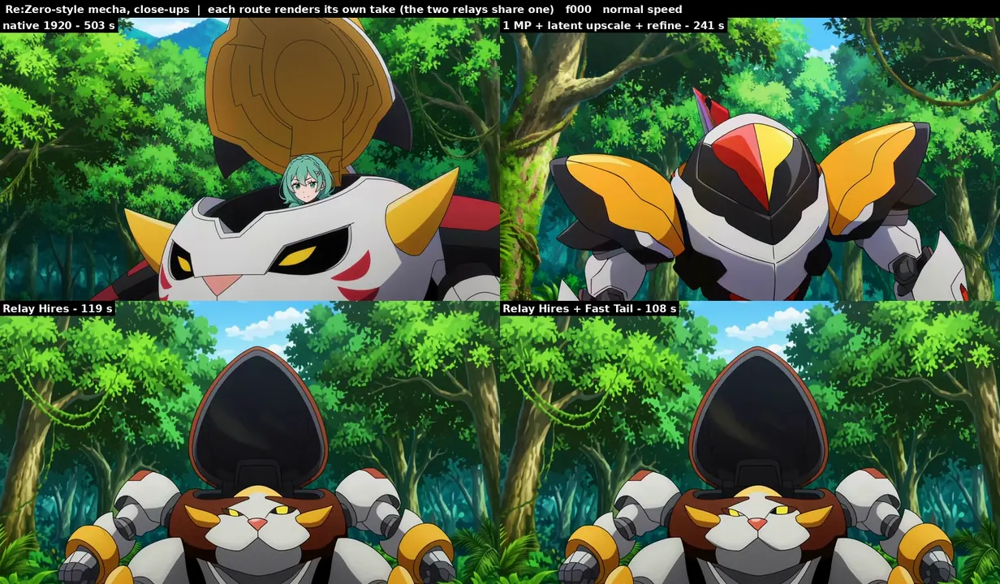
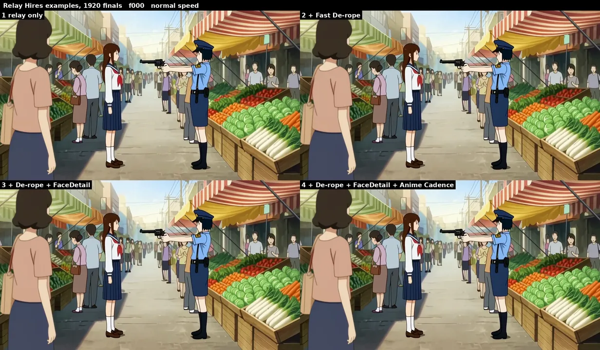

# H3 Relay Hires

Render a MiniMax H3 take small, finish it at 1920x1088: **about half the time of an upscaled 1 MP render and a quarter
of a native 1920 render**, keeping the take you previewed and its audio. Built for 2D anime.

[](assets/rezero_four_routes.mp4)

*Top: native 1920 render (503 s), 1 MP render + latent upscale + refine (241 s). Bottom: Relay Hires (119 s), and Relay
Hires with the H3 Fast Tail Sampler in pass 1 (108 s). Each route renders its own take, so compare the drawing, not the
pose; the two relays share one. Click for the full clip (with sound, then half speed).*

## Results

5 s clips (124 frames), 1920x1088, RTX 5090, end to end (text encode, sampling, decodes, saves):

| clip | native 1920 | 1 MP + latent upscale + refine | **Relay Hires** | **+ Fast Tail** |
|---|---|---|---|---|
| Teen Titans-style punch | 492 s | 240 s | **116 s** | **105 s** |
| plain-H3 sword fight | 503 s | 241 s | **118 s** | **107 s** |
| Edgerunners-style rocket | 508 s | 245 s | **121 s** | **109 s** |
| Re:Zero-style mecha, close-ups | 503 s | 241 s | **119 s** | **108 s** |
| Re:Zero-style wide shot, small faces | 500 s | 239 s | **117 s** | **106 s** |

*+ Fast Tail*: the same Relay Hires with the H3 Fast Tail Sampler in pass 1 ([below](#faster-pass-1-h3-fast-tail-sampler)),
same take. The two relay columns were measured in one session (Relay Hires renders bit-identical to its first test,
which also saved an AnimeSR-only comparison video and took 122-126 s); native and 1 MP are from the original tests.

- **Same take as the 0.5 MP preview**, and its soundtrack sample for sample (the audio is pinned outright).
- **Crisp at 1:1**: the preview's melted fast-frame faces and motion smears are redrawn as proper drawings, and small
  faces in wide shots come out clean (below: 0.5 MP preview | AnimeSR alone | Relay Hires, 1:1 crops at 1920).
- **Steady**: frame-to-frame change on still content 0.13 (native 0.10, the 1 MP route 0.22).
- **Line weight** is the remaining gap to native: ink lines ~3.1-3.9 px vs ~2.2-3.0 px native.
- **Very fast action**: where the 0.5 MP take itself melts (a sword clash), the result is motion blur, not crisp
  poses. Fix those frames at 0.5 MP first with a de-rope pass (example workflow 2), then relay.


## How it works

1. **Pass 1 at 0.5 MP** (960x544) decides layout, motion, acting and audio. That's where most of a render's time goes,
   so that's where the saving is: 60 s instead of 151 s at 1 MP.
2. **AnimeSR** upscales the decoded frames to the target size in ~2 s (see below).
3. **One DMAD step from sigma 0.60** at the target size redraws the detail: the frames are encoded (taeh3 is enough),
   re-noised to 0.60 and denoised in one turbo step with the pass-1 audio pinned, then decoded.

Why these settings (measured, see the development notes):
- **sigma 0.60**: 0.45 stays soft from a 0.5 MP take; 0.75 starts redrawing fast frames (new faces, re-smeared limbs).
- **1 step**: looks the same as 2, slightly steadier, 21 s less.
- **dense attention**: temporal window attention is ~9 s faster but makes still lines shimmer unless every chunk also
  sees shared anchor frames, and even then it's a little less steady.

## Faster pass 1: H3 Fast Tail Sampler

Pass 1 is still the biggest cost: 58 s of a ~120 s relay-only render, 285 s of a 15 s clip through the full pipeline.
**H3 Fast Tail Sampler** takes ~20% off it without changing the take. Use it in pass 1 instead of KSamplerSelect
`euler` and keep BasicScheduler `beta57` 20 (example workflows 5-8 do).

- H3 decides layout, acting and audio timing in the first 12 of the 20 steps (sigma >= 0.79), and that part is
  chaotic: fewer steps, more steps (even 40) or another solver all give a different take. The sampler runs those 12
  steps exactly as `euler` does, bit for bit.
- Below 0.79 the path is smooth, so the last 8 steps become 4 second-order steps (DPM++ 2M with its step ratio
  measured in H3's flow log-SNR). Checked against a near-exact finish of the same take (a 32-step tail), they land as
  close to it as the 8 euler steps do, in fine detail and in the soundtrack.
- RTX 5090, end to end: examples 1-4 -> 5-8 9-12 s faster each (pass 1 58 -> 47 s); 15 s clips through the full
  pipeline 706 -> ~650 s and 814 -> 752 s (pass 1 285 -> 229 s). The 1920 results match: same frames and poses (29-34
  dB PSNR to the euler render, where a different take measures 13-19 dB), same ink-line width and still-line flicker.
- The soundtrack comes out ~0.5 dB louder than with euler (euler's 8-step finish is ~0.5 dB under the near-exact
  one), and Anime Cadence may place a 2s/3s hold one frame differently.
- Settings: `decide_above` 0.79, `tail_steps` 4, `tail_solver` dpmpp_2m_flow. `tail_steps` 3 is ~25% faster but drops a
  few tiny sparks and particles; a lower `decide_above` changes the take and makes the audio louder.

## AnimeSR

H3 draws ink lines ~2 px wide at **every** resolution, so a 0.5 MP take has lines twice too thick for 1920. AnimeSR is a
small arbitrary-scale upscaler (1.3 M params, 5 MB) trained from scratch to undo that:

- **Architecture** (`animesr.py`): residual conv blocks at the input resolution, a 4-conv head at the output
  resolution that sees the features, the bicubic upscale, each output pixel's sub-pixel offset and the scale. One model
  for any input from 0.47x to 0.72x of the target; it starts training as exact bicubic.
- **Data**: ~1,700 1080p anime clips and stills -> 9,470 training pairs. Low-res inputs are made the way H3 makes them:
  downscaled 0.47-0.72x and round-tripped through H3's own video VAE (in video mode), and 80% of them get H3-thick ink
  lines (thin dark lines thickened at low res); the targets keep the real thin lines.
- **Result**: on real 0.5 MP H3 frames its lines come out at 2.7 px at 1920 vs 3.3 px for Lanczos, with clean fills and
  no ringing. Because the H3 step keeps much of the start image's line width, this carries into the result.

AnimeSR alone (no H3 step) is the cheapest 1920 path (~80 s), but it keeps the take's smears and mushy small faces.

## Nodes

| node | what it does |
|---|---|
| **H3 Relay Hires** | the whole method in one node. Inputs: the pass-1 model with the DMAD LoRA at 0.8 (same style LoRAs and shift), the pass-1 conditioning, the pass-1 AV latent (for its audio), the pass-1 frames, a VAE for the encode (taeh3). Outputs the AV latent at the target size, plus the upscaled frames. |
| H3 Fast Tail Sampler | pass-1 sampler in place of KSamplerSelect `euler`: the steps where H3 decides the take run as euler, then a short 2nd-order tail. Pass 1 ~20% faster, same take ([below](#faster-pass-1-h3-fast-tail-sampler)) |
| H3 Relay Upscale (AnimeSR) | AnimeSR alone: frames -> any size |
| H3 Relay Window Attention | temporal window attention, with anchor frames (research / speed option) |
| H3 Relay Anchor, H3 Relay Line Thin | research tools from development, not part of the recipe |

Settings on H3 Relay Hires: `sigma_start` 0.60, `steps` 1, `window` 0. `window` 4 (with `anchor_stride` 8) is ~9 s faster
with slightly more shimmer on still lines. The `upscaler` list shows AnimeSR models in `models/` plus `lanczos`.

## Example workflows

Eight workflows in `example_workflows/`, all rendering the same take (a street-market fight, plain H3 without a style
LoRA, seed 101). 1-4 each add one stage of an anime pipeline at 0.5 MP before the relay; 5-8 are the same four with the
H3 Fast Tail Sampler in pass 1 (same take, 9-12 s faster). A blue SETTINGS group holds the pass-1 size (aspect +
megapixels, 0.5 MP), the hires scale (2.0) and one prompt box; each saves the 0.5 MP preview and the 1920 result.

[](assets/examples_1to4.mp4)

*The four workflows' 1920 results side by side: 1 relay only | 2 + Fast De-rope / 3 + FaceDetail | 4 + Anime Cadence. Click for the full clip (with sound, then half speed).*

| workflow | what it adds | end to end* | packs it needs besides this one |
|---|---|---|---|
| [`1_relay_hires.json`](example_workflows/1_relay_hires.json) | relay only | 118 s | FastDerope (its taeh3 loader) |
| [`2_relay_hires_derope.json`](example_workflows/2_relay_hires_derope.json) | Fast De-rope: smeared fast motion comes back as clean drawings on 2s before the relay | 144 s | FastDerope, MAINodes |
| [`3_relay_hires_derope_facedetail.json`](example_workflows/3_relay_hires_derope_facedetail.json) | + FaceDetail: small faces redrawn at 0.5 MP; its face tiles are stitched again onto the 1920 frames, so the final keeps the preview's faces | 224 s | + FaceDetail, ResCascade |
| [`4_relay_hires_derope_facedetail_cadence.json`](example_workflows/4_relay_hires_derope_facedetail_cadence.json) | + Anime Cadence: 2s/3s holds, carried to 1920 by Hold Transfer | 228 s | + AnimeCadence |
| [`5_relay_hires_fast_tail.json`](example_workflows/5_relay_hires_fast_tail.json) | 1 with the H3 Fast Tail Sampler in pass 1 | 110 s\*\* | as 1 |
| [`6_relay_hires_derope_fast_tail.json`](example_workflows/6_relay_hires_derope_fast_tail.json) | 2 with the H3 Fast Tail Sampler in pass 1 | 134 s\*\* | as 2 |
| [`7_relay_hires_derope_facedetail_fast_tail.json`](example_workflows/7_relay_hires_derope_facedetail_fast_tail.json) | 3 with the H3 Fast Tail Sampler in pass 1 | 209 s\*\* | as 3 |
| [`8_relay_hires_derope_facedetail_cadence_fast_tail.json`](example_workflows/8_relay_hires_derope_facedetail_cadence_fast_tail.json) | 4 with the H3 Fast Tail Sampler in pass 1 | 213 s\*\* | as 4 |

*1920x1088, 124 frames (5 s), RTX 5090. FaceDetail's cost depends on the clip: here it redrew four face tracks of
~30 px and took ~80 s, re-stitch included.

\*\*Timed in one session together with a re-run of 1-4 (122 / 146 / 218 / 222 s there): the whole difference is pass 1,
58 -> 47 s; FaceDetail's CPU steps vary by a few seconds between runs.

- In workflow 4 the relay renders the frames *before* Anime Cadence (so FaceDetail's tiles stay on their frames).
  Hold Transfer then copies the 0.5 MP holds onto the 1920 frames; with its `source` input each hold shows the drawing
  Cadence picked (needs ResCascade da05159 or later). Don't run Anime Cadence again after the relay.
- Packs: [FastDerope](https://github.com/tazmannner/ComfyUI-H3-FastDerope),
  [MAINodes](https://github.com/matlowai/ComfyUI-MAINodes),
  [FaceDetail](https://github.com/tazmannner/ComfyUI-H3-FaceDetail) (with its anime face detector),
  [ResCascade](https://github.com/tazmannner/ComfyUI-H3-ResCascade),
  [AnimeCadence](https://github.com/tazmannner/ComfyUI-H3-AnimeCadence); all four workflows also use
  [VideoHelperSuite](https://github.com/Kosinkadink/ComfyUI-VideoHelperSuite) and comfyui_essentials (SimpleMath+).

## Requirements

- MiniMax H3 in ComfyUI (the example workflows load the fp16 and int8 video VAEs and the audio VAE), the DMAD 4-step
  turbo LoRA for H3
- a taeh3 loader for the encode (e.g. ComfyUI-H3-FastDerope's)
- `models/animesr_v1.safetensors` (included)
- the example workflows also use comfyui_essentials (SimpleMath+) for the size settings, and the packs listed above

## Train AnimeSR yourself

```bash
tar -cf - my_1080p_clips/ my_1080p_stills/ | python training/prep.py > pairs.tar    # ComfyUI's Python + GPU (H3 VAE)
cat pairs.tar | ITERS=12000 OUT=run python training/train.py                       # ~22 min on an RTX 5090
```

`prep.py` keeps 1920x1080 sources only and holds out 1 in 25 for validation; `train.py` saves
`run/animesr_best.safetensors` (copy it into `models/`) and before/after PNGs of held-out frames.

## Measuring

- `tools/line_width.py video.mp4`: median ink-line width (px at 1920 scale)
- `tools/static_flicker.py video.mp4`: frame-to-frame change on the most static parts of a shot (shimmer/boil)

## License

MIT
