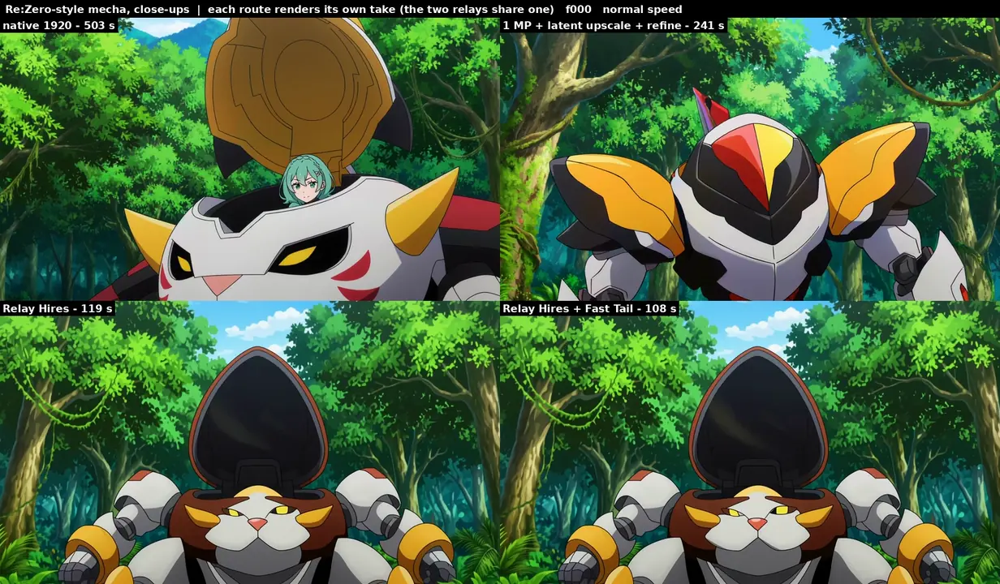
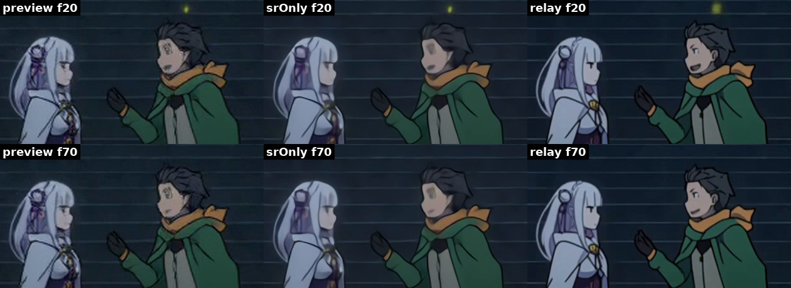
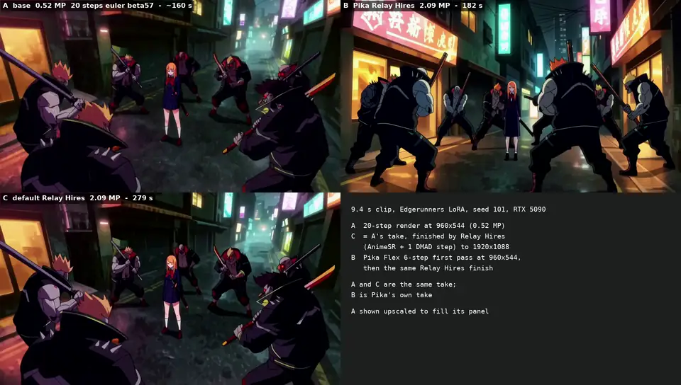
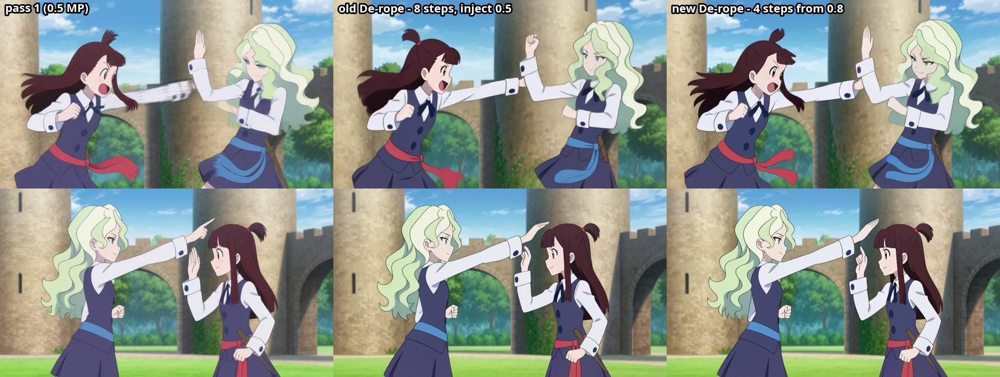
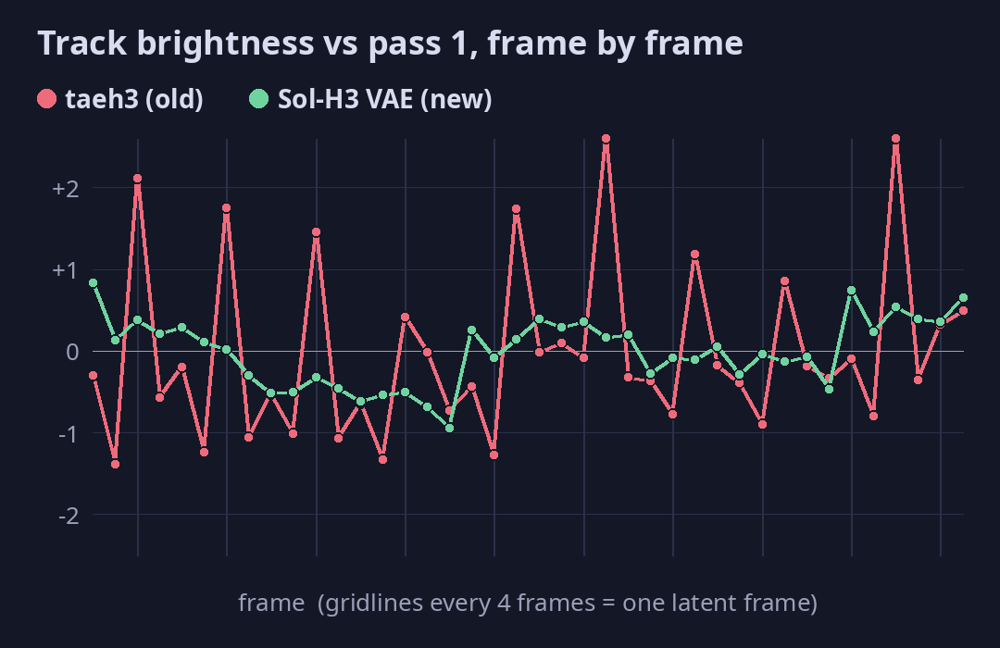
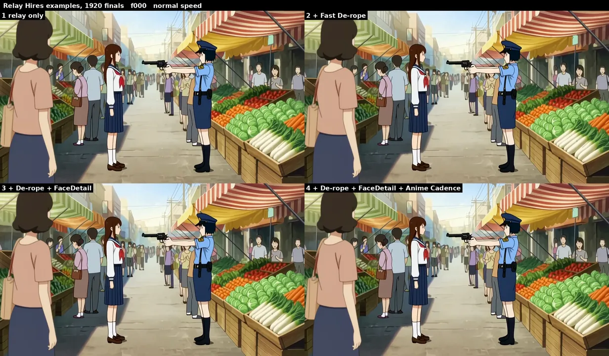

# H3 Relay Hires

Render a MiniMax H3 take small, finish it at 1920x1088: **about half the time of an upscaled 1 MP render and a quarter
of a native 1920 render**, keeping the take you previewed and its audio. Built for 2D anime.

[](assets/rezero_four_routes.mp4)

*Top: native 1920 render (503 s), 1 MP render + latent upscale + refine (241 s). Bottom: Relay Hires (119 s), and Relay
Hires with the H3 Fast Tail Sampler in pass 1 (108 s). Each route renders its own take, so compare the drawing, not the
pose; the two relays share one. Click for the full clip (with sound, then half speed).*

## Results

5 s clips (124 frames), 1920x1088, RTX 5090, end to end (text encode, sampling, decodes, saves):

| clip | native 1920 | 1 MP + latent upscale + refine | **Relay Hires** | **+ Fast Tail** |
|---|---|---|---|---|
| Teen Titans-style punch | 492 s | 240 s | **116 s** | **105 s** |
| plain-H3 sword fight | 503 s | 241 s | **118 s** | **107 s** |
| Edgerunners-style rocket | 508 s | 245 s | **121 s** | **109 s** |
| Re:Zero-style mecha, close-ups | 503 s | 241 s | **119 s** | **108 s** |
| Re:Zero-style wide shot, small faces | 500 s | 239 s | **117 s** | **106 s** |

Measured with dense attention on the 1920 step; the 4-frame window the example workflows use since 0.2.1 takes another
~7 s off these 5 s clips and about half the 1920 step on 10-15 s clips ([bench](#bench-pika-vs-dmad-window-attention-de-rope-schedule)).
*+ Fast Tail*: the same Relay Hires with the H3 Fast Tail Sampler in pass 1 ([below](#faster-pass-1-h3-fast-tail-sampler)),
same take. The two relay columns were measured in one session (Relay Hires renders bit-identical to its first test,
which also saved an AnimeSR-only comparison video and took 122-126 s); native and 1 MP are from the original tests.

- **Same take as the 0.5 MP preview**, and its soundtrack sample for sample (the audio is pinned outright).
- **Crisp at 1:1**: the preview's melted fast-frame faces and motion smears are redrawn as proper drawings, and small
  faces in wide shots come out clean (below: 0.5 MP preview | AnimeSR alone | Relay Hires, 1:1 crops at 1920).
- **Steady**: frame-to-frame change on still content 0.13 (native 0.10, the 1 MP route 0.22).
- **Line weight** is the remaining gap to native: ink lines ~3.1-3.9 px vs ~2.2-3.0 px native.
- **Very fast action**: where the 0.5 MP take itself melts (a sword clash), the result is motion blur, not crisp
  poses. Fix those frames at 0.5 MP first with a de-rope pass (example workflow 2), then relay.



## How it works

1. **Pass 1 at 0.5 MP** (960x544) decides layout, motion, acting and audio. That's where most of a render's time goes,
   so that's where the saving is: 60 s instead of 151 s at 1 MP.
2. **AnimeSR** upscales the decoded frames to the target size in ~2 s (see below).
3. **One DMAD step from sigma 0.60** at the target size redraws the detail: the frames are encoded (taeh3 is enough),
   re-noised to 0.60 and denoised in one turbo step with the pass-1 audio pinned, then decoded. If the 1920 result
   pulses in brightness every 4 frames, encode and decode with the Sol-H3 VAE instead
   ([below](#flicker-fix-sol-h3-vae-on-the-1920-step-optional)).

Why these settings (measured, see the development notes):
- **sigma 0.60**: 0.45 stays soft from a 0.5 MP take; 0.75 starts redrawing fast frames (new faces, re-smeared limbs).
- **1 step**: looks the same as 2, slightly steadier, 21 s less.
- **window attention 4, anchors every 8th latent frame** (the example workflows since 0.2.1): each frame attends to
  its neighbours plus shared anchor frames. On 10-15 s clips the 1920 step takes about half the time of dense attention
  (11.5 s clip 115 -> 64 s, 10 s fight 92 -> 53 s) with the same sharpness and the same still-line flicker
  (`tools/static_flicker.py` 1.451 vs 1.439 dense, 1.608 vs 1.595). Without anchors still lines shimmer. `window` 0
  is dense, the node's own default.

## Faster pass 1: H3 Fast Tail Sampler

Pass 1 is still the biggest cost: 58 s of a ~120 s relay-only render, 285 s of a 15 s clip through the full pipeline.
**H3 Fast Tail Sampler** takes ~20% off it without changing the take. Use it in pass 1 instead of KSamplerSelect
`euler` and keep BasicScheduler `beta57` 20 (example workflows 5-8 do).

- H3 decides layout, acting and audio timing in the first 12 of the 20 steps (sigma >= 0.79), and that part is
  chaotic: fewer steps, more steps (even 40) or another solver all give a different take. The sampler runs those 12
  steps exactly as `euler` does, bit for bit.
- Below 0.79 the path is smooth, so the last 8 steps become 4 second-order steps (DPM++ 2M with its step ratio
  measured in H3's flow log-SNR). Checked against a near-exact finish of the same take (a 32-step tail), they land as
  close to it as the 8 euler steps do, in fine detail and in the soundtrack.
- RTX 5090, end to end: examples 1-4 -> 5-8 9-12 s faster each (pass 1 58 -> 47 s); 15 s clips through the full
  pipeline 706 -> ~650 s and 814 -> 752 s (pass 1 285 -> 229 s). The 1920 results match: same frames and poses (29-34
  dB PSNR to the euler render, where a different take measures 13-19 dB), same ink-line width and still-line flicker.
- The soundtrack comes out ~0.5 dB louder than with euler (euler's 8-step finish is ~0.5 dB under the near-exact
  one), and Anime Cadence may place a 2s/3s hold one frame differently.
- Settings: `decide_above` 0.79, `tail_steps` 4, `tail_solver` dpmpp_2m_flow. `tail_steps` 3 is ~25% faster but drops a
  few tiny sparks and particles; a lower `decide_above` changes the take and makes the audio louder.

**Without this pack (stock ComfyUI nodes).** The same pass 1 can be wired from core nodes:

1. BasicScheduler (`beta57`, 20) -> SplitSigmas (`step` 12)
2. SamplerCustomAdvanced #1: your RandomNoise, KSamplerSelect `euler`, SplitSigmas' high sigmas
3. ManualSigmas `0.7903, 0.65766, 0.44654, 0.17186, 0` (the 4 tail points of beta57 20 at shift 12)
4. SamplerCustomAdvanced #2: DisableNoise, SamplerDPMPP_2M_SDE (`eta` 0, `solver_type` midpoint), the ManualSigmas,
   the latent from #1. Decode the video and the audio from #2.

With `eta` 0 that sampler is the same DPM++ 2M in flow log-SNR as the node's tail; on the market clip it renders the
node's take (32.6 dB PSNR, soundtrack correlation 0.995, same loudness). What the node adds: one node instead of five,
tail points picked from whatever schedule it gets (the ManualSigmas values above only fit beta57, 20 steps, shift 12),
and no hand-off between two samplers. The head is euler in both; the idea (keep the steps above 0.79, shorten the tail)
should carry over to other samplers but was only measured with euler.

## Max speed: Pika H3 Flex in pass 1

[Pika H3 Flex](https://github.com/Pika-Labs/Pika-H3-Flex) is a distilled turbo LoRA for H3: pass 1 in 6 steps instead
of 20. In front of Relay Hires it's the fastest route we've tested, but it **renders its own take**: same prompt and
seed, different framing, character designs, acting and soundtrack. Not worse, different. Use it when you want max
speed; keep the 20-step pass 1 (examples 1-8) when you want the base model's take. Example workflows `1_B` and `4_B`
are 1 and 4 with it (111 -> 69 s and 216 -> 174 s; pass 1 60 -> 22 s).

[](assets/cyber_pika_3way_audio_tour.mp4)

*9.4 s clip, seed 101. A: the 20-step pass 1 at 0.5 MP. C: that take through Relay Hires (279 s). B: Pika pass 1 +
the same Relay Hires (182 s). Click for the clip with sound: each version's soundtrack plays in turn.*

- **Time**: this 9.4 s clip 279 -> 182 s (pass 1 ~42 s); a 15 s clip through the full pipeline (de-rope, FaceDetail,
  cadence) 814 -> 646 s.
- **Audio**: also its own take. Dialogue and sound effects come through, but quiet background music can drop out (the
  alley's low synth drone did). Describe music explicitly and loudly ("a loud, driving synthwave track, clearly
  audible from the first second") and it comes back.
- **Settings**: LoRA 1.0 (the fl2va file for t2v, the ref2va file for Ref2VA) *before* MiniMaxH3SigmaShift (keep 12/3
  in the model path), ManualSigmas `1.0, 0.972973, 0.923077, 0.8, 0.571429, 0.333333, 0`, sampler `lcm`, cfg 1
  (BasicGuider). The relay's 1920 step stays DMAD 0.8: Pika there is softer at 1 step, and 2 Pika steps from 0.57
  look the same as DMAD for ~100 s more ([bench](#bench-pika-vs-dmad-window-attention-de-rope-schedule)). The Fast
  Tail Sampler doesn't apply (it shortens the 20-step schedule), so there's no Pika version of 5-8.

## AnimeSR

H3 draws ink lines ~2 px wide at **every** resolution, so a 0.5 MP take has lines twice too thick for 1920. AnimeSR is a
small arbitrary-scale upscaler (1.3 M params, 5 MB) trained from scratch to undo that:

- **Architecture** (`animesr.py`): residual conv blocks at the input resolution, a 4-conv head at the output
  resolution that sees the features, the bicubic upscale, each output pixel's sub-pixel offset and the scale. One model
  for any input from 0.47x to 0.72x of the target; it starts training as exact bicubic.
- **Data**: ~1,700 1080p anime clips and stills -> 9,470 training pairs. Low-res inputs are made the way H3 makes them:
  downscaled 0.47-0.72x and round-tripped through H3's own video VAE (in video mode), and 80% of them get H3-thick ink
  lines (thin dark lines thickened at low res); the targets keep the real thin lines.
- **Result**: on real 0.5 MP H3 frames its lines come out at 2.7 px at 1920 vs 3.3 px for Lanczos, with clean fills and
  no ringing. Because the H3 step keeps much of the start image's line width, this carries into the result.

AnimeSR alone (no H3 step) is the cheapest 1920 path (~80 s), but it keeps the take's smears and mushy small faces.

## Bench: Pika vs DMAD, window attention, De-rope schedule

2026-11-03, on three Ref2VA anime clips (11.5 s dialogue, 15 s wide shots with small faces, 10 s fist fight), each
variant on the same take (soundtrack correlation 1.000), so only the stage under test changes. Prompted by a
community workflow that swaps DMAD for the Pika H3 Flex ref2va LoRA in every pass after pass 1, upscales with lanczos,
runs the 1920 step 2 steps from 0.57 with a 4-frame window and encodes with the full VAE.

| change | result | verdict |
|---|---|---|
| that workflow as a whole | clearly softer at 1920 (Laplacian sharpness 25 vs 78): lanczos + a lower start hand the detail step a blurrier image than AnimeSR at 0.60 | not adopted |
| full int8 VAE for the 1920 encode instead of taeh3 | softer (54 vs 78) and ~60 s slower | not adopted (but see the [Sol-H3 VAE](#flicker-fix-sol-h3-vae-on-the-1920-step-optional) for the 4-frame pulse) |
| Pika in the 1920 step, 1 step at 0.60 | softer than DMAD (169 vs 187) | not adopted |
| Pika in the 1920 step, 2 steps from 0.57 | +8% sharpness on paper, no visible difference, +100 s | not adopted |
| Pika in FaceDetail | same faces as DMAD (mean difference ~1/255); on Pika's own sigma knots one step fewer on mid-size faces (133 -> 99 s) | optional |
| Pika in Fast De-rope (3 lcm steps from 0.8) | keeps pass 1's framing, but drops eye highlights, smudges cheeks, thins sleeve folds | not adopted |
| **Fast De-rope pass 2: 4 DMAD steps from 0.8** instead of the 8-step inject-0.5 schedule | keeps pass 1's framing and character positions (the old schedule moved the camera and re-staged the fight) with DMAD's line detail, same time (37 vs 38 s); on the examples' market clip the redrawn span stays closer to pass 1 too (mean difference 7.6 vs 10.1) | **examples 2-4, 6-8, 4_B** |
| **window 4 + anchors every 8 on the 1920 step** | about half the time of dense (115 -> 64 s, 92 -> 53 s), same sharpness and still-line flicker | **all examples** |
| Pika vs the 20-step pass 1, audio | same take and loudness; the 20-step take had a fuller music bed, Pika's took 3x less time | Pika stays the max-speed option |



*Pass 1 (left) | old De-rope schedule (middle) | new (right). The old 8-step inject-0.5 pass re-stages the take: the
camera moves in and the punch becomes a new pose. From 0.8 the redraw keeps pass 1's framing and positions and
still cleans the smeared arm. Hands can still change (Diana's pointing finger becomes a flat hand in both).*

Still open: the motion gate splices one continuous span, so a calm close-up between fast shots gets redrawn too and
loses pass-1 detail such as eye highlights. Limiting the redraw to the fast shots is planned in Fast De-rope.

## Flicker fix: Sol-H3 VAE on the 1920 step (optional)

taeh3 encodes each latent frame (4 video frames) a little off, so after the 1920 step every 4th frame can come out
brighter: ~1.5 luma on average and ~3 on big flat areas, a slow shimmer on running tracks, floors and skies. Pass 1
and the 0.5 MP stages don't have it; it starts at the relay's encode. It's strong on bright flat shots and faint on
busy ones: on a sports-day establishing shot the red track jumps +2.9 every 4th frame; on the market fight of the
examples the 4-frame pattern is only ±0.16. Window attention doesn't matter (dense and window 4 pulse the same).

If you see it, use [`4_relay_hires_derope_facedetail_cadence_SOLVAE.json`](example_workflows/4_relay_hires_derope_facedetail_cadence_SOLVAE.json),
or change any workflow by hand: load `minimax_h3_sol_vae_int8_convrot.safetensors` (from
[Comfy-Org/MiniMax-H3](https://huggingface.co/Comfy-Org/MiniMax-H3), `vae/`; base model
[Efficient-Large-Model/Sol-H3-VAE](https://huggingface.co/Efficient-Large-Model/Sol-H3-VAE)) with a VAELoader and wire
it into **H3 Relay Hires**' `vae` (the encode) and the **1920 VAE Decode** (or H3 Relay Finish's `vae`). Sol has its own
encoder, so the latent frames come out even; its distilled decoder is the fast part.



| 1920 step (sports day, 15 s) | 4-frame pulse (track) | fine detail (Laplacian) | relay node (encode + step) + 1920 decode |
|---|---|---|---|
| taeh3 (all other examples) | +2.9 | 4.9-5.3 | 91 + 38 s |
| full int8 VAE | none | 4.3-4.7 | 169 + 38 s |
| **Sol-H3 VAE** | **none** | 4.4-4.9 | 168 + 15 s |

At 1:1 the line art and eyes look the same in all three. On the 5 s example clip the SOLVAE workflow takes 244 s end to
end against 217 s for example 4 (the 1920 step 37 -> 58 s): Sol's encode is as slow as the full VAE's, its decode is
faster than the stock one. The other examples keep taeh3, since most clips don't show the pulse.

Also tried: a community anime fine-tune of the H3 VAE
([Seamless Anime VAE](https://civitai.com/models/3025416/minimax-h3-seamless-anime-vae)) on both ends. No pulse either
and visibly fewer 16-px grid blocks at 4x zoom (grid ratio 1.15 vs Sol 1.40), but at normal size it looks the same as
Sol, and it's ~50 s slower on 15 s (full-size decoder).

## Nodes

| node | what it does |
|---|---|
| **H3 Relay Hires** | the whole method in one node. Inputs: the pass-1 model with the DMAD LoRA at 0.8 (same style LoRAs and shift), the pass-1 conditioning, the pass-1 AV latent (for its audio), the pass-1 frames, a VAE for the encode (taeh3). Outputs the AV latent at the target size, plus the upscaled frames. |
| H3 Fast Tail Sampler | pass-1 sampler in place of KSamplerSelect `euler`: the steps where H3 decides the take run as euler, then a short 2nd-order tail. Pass 1 ~20% faster, same take ([below](#faster-pass-1-h3-fast-tail-sampler)) |
| H3 Relay Upscale (AnimeSR) | AnimeSR alone: frames -> any size |
| H3 Relay Window Attention | temporal window attention, with anchor frames (research / speed option) |
| H3 Relay Anchor, H3 Relay Line Thin | research tools from development, not part of the recipe |

Settings on H3 Relay Hires: `sigma_start` 0.60, `steps` 1, `window` 4 with `anchor_stride` 8 (the example workflows;
`window` 0 = dense, the node default, about twice as slow on long clips for the same result). The `upscaler` list
shows AnimeSR models in `models/` plus `lanczos`.

## Example workflows

Ten workflows in `example_workflows/`, all on the same prompt (a street-market fight, plain H3 without a style LoRA,
seed 101). 1-4 each add one stage of an anime pipeline at 0.5 MP before the relay; 5-8 are the same four with the
H3 Fast Tail Sampler in pass 1 (same take, 9-12 s faster); 1_B and 4_B are 1 and 4 with Pika H3 Flex in pass 1
(fastest, Pika's own take, [above](#max-speed-pika-h3-flex-in-pass-1)). Two variants of 4 change only the 1920 end:
4_B_..._LOWRAM (H3 Relay Finish, less RAM) and 4_..._SOLVAE (the Sol-H3 VAE, for the
[4-frame flicker](#flicker-fix-sol-h3-vae-on-the-1920-step-optional)). A blue SETTINGS group holds the pass-1 size (aspect +
megapixels, 0.5 MP), the hires scale (2.0) and one prompt box; each saves the 0.5 MP preview and the 1920 result.

[](assets/examples_1to4.mp4)

*The four workflows' 1920 results side by side: 1 relay only | 2 + Fast De-rope / 3 + FaceDetail | 4 + Anime Cadence. Click for the full clip (with sound, then half speed).*

| workflow | what it adds | end to end* | packs it needs besides this one |
|---|---|---|---|
| [`1_relay_hires.json`](example_workflows/1_relay_hires.json) | relay only | 111 s | FastDerope (its taeh3 loader) |
| [`2_relay_hires_derope.json`](example_workflows/2_relay_hires_derope.json) | Fast De-rope: smeared fast motion comes back as clean drawings on 2s before the relay | 136 s | FastDerope, MAINodes |
| [`3_relay_hires_derope_facedetail.json`](example_workflows/3_relay_hires_derope_facedetail.json) | + FaceDetail: small faces redrawn at 0.5 MP; its face tiles are stitched again onto the 1920 frames, so the final keeps the preview's faces | 212 s | + FaceDetail, ResCascade |
| [`4_relay_hires_derope_facedetail_cadence.json`](example_workflows/4_relay_hires_derope_facedetail_cadence.json) | + Anime Cadence: 2s/3s holds, carried to 1920 by Hold Transfer | 216 s | + AnimeCadence |
| [`5_relay_hires_fast_tail.json`](example_workflows/5_relay_hires_fast_tail.json) | 1 with the H3 Fast Tail Sampler in pass 1 | 97 s\*\* | as 1 |
| [`6_relay_hires_derope_fast_tail.json`](example_workflows/6_relay_hires_derope_fast_tail.json) | 2 with the H3 Fast Tail Sampler in pass 1 | 122 s\*\* | as 2 |
| [`7_relay_hires_derope_facedetail_fast_tail.json`](example_workflows/7_relay_hires_derope_facedetail_fast_tail.json) | 3 with the H3 Fast Tail Sampler in pass 1 | 198 s\*\* | as 3 |
| [`8_relay_hires_derope_facedetail_cadence_fast_tail.json`](example_workflows/8_relay_hires_derope_facedetail_cadence_fast_tail.json) | 4 with the H3 Fast Tail Sampler in pass 1 | 201 s\*\* | as 4 |
| [`1_B_relay_hires_PIKA6STEP.json`](example_workflows/1_B_relay_hires_PIKA6STEP.json) | 1 with Pika H3 Flex in pass 1 (6 steps, its own take) | 69 s\*\* | as 1, + the Pika H3 Flex fl2va LoRA |
| [`4_B_relay_hires_derope_facedetail_cadence_PIKA6STEP.json`](example_workflows/4_B_relay_hires_derope_facedetail_cadence_PIKA6STEP.json) | 4 with Pika H3 Flex in pass 1 (6 steps, its own take) | 174 s\*\* | as 4, + the Pika H3 Flex fl2va LoRA |
| [`4_relay_hires_derope_facedetail_cadence_SOLVAE.json`](example_workflows/4_relay_hires_derope_facedetail_cadence_SOLVAE.json) | 4 with the Sol-H3 VAE for the 1920 encode and decode: no 4-frame brightness flicker | 244 s | as 4, + the Sol-H3 int8 VAE |

*1920x1088, 124 frames (5 s), RTX 5090. FaceDetail's cost depends on the clip: here it redrew four face tracks of
~30 px and took ~80 s, re-stitch included.

\*\*Timed in the session right after 1-4 (0.2.1 settings: window 4 on the 1920 step, De-rope from 0.8); the stages
already cached from that run (text encode, model loads, ~4 s) are counted with their times from it. Pass 1 61 -> 47 s
with the Fast Tail, 19 s with Pika. Against 0.2.0 the window saves 8 s on the 1920 step (32 -> 24 s) and De-rope's
pass 2 takes the same time (15 -> 14 s); the rest is FaceDetail's CPU steps, which vary by several seconds between runs.

- In workflow 4 the relay renders the frames *before* Anime Cadence (so FaceDetail's tiles stay on their frames).
  Hold Transfer then copies the 0.5 MP holds onto the 1920 frames; with its `source` input each hold shows the drawing
  Cadence picked (needs ResCascade da05159 or later). Don't run Anime Cadence again after the relay.
- Packs: [FastDerope](https://github.com/tazmannner/ComfyUI-H3-FastDerope),
  [MAINodes](https://github.com/matlowai/ComfyUI-MAINodes),
  [FaceDetail](https://github.com/tazmannner/ComfyUI-H3-FaceDetail) (with its anime face detector),
  [ResCascade](https://github.com/tazmannner/ComfyUI-H3-ResCascade),
  [AnimeCadence](https://github.com/tazmannner/ComfyUI-H3-AnimeCadence); all four workflows also use
  [VideoHelperSuite](https://github.com/Kosinkadink/ComfyUI-VideoHelperSuite) and comfyui_essentials (SimpleMath+).

## Requirements

- MiniMax H3 in ComfyUI (the example workflows load the fp16 and int8 video VAEs and the audio VAE), the DMAD 4-step
  turbo LoRA for H3
- a taeh3 loader for the encode (e.g. ComfyUI-H3-FastDerope's); the SOLVAE example uses the Sol-H3 int8 VAE instead
- `models/animesr_v1.safetensors` (included)
- the example workflows also use comfyui_essentials (SimpleMath+) for the size settings, and the packs listed above

## Train AnimeSR yourself

```bash
tar -cf - my_1080p_clips/ my_1080p_stills/ | python training/prep.py > pairs.tar    # ComfyUI's Python + GPU (H3 VAE)
cat pairs.tar | ITERS=12000 OUT=run python training/train.py                       # ~22 min on an RTX 5090
```

`prep.py` keeps 1920x1080 sources only and holds out 1 in 25 for validation; `train.py` saves
`run/animesr_best.safetensors` (copy it into `models/`) and before/after PNGs of held-out frames.

## Measuring

- `tools/line_width.py video.mp4`: median ink-line width (px at 1920 scale)
- `tools/static_flicker.py video.mp4`: frame-to-frame change on the most static parts of a shot (shimmer/boil)

## License

MIT
